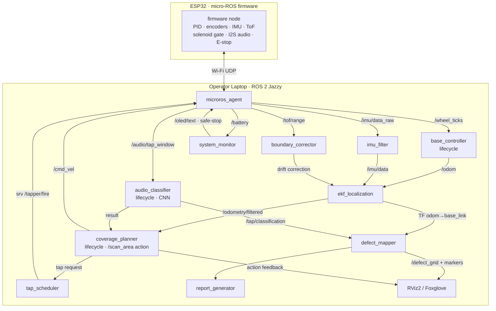

# TapMap: An Autonomous Percussive Defect-Mapping Rover
## Complete Engineering Design Document (v1.0)

**Budget cap:** ₹6,000 (design target ₹5,200) · **Build window:** 8–10 weeks · **Middleware:** ROS 2 Jazzy (LTS) + micro-ROS · **Compute:** ESP32 (robot) + laptop (operator station)

> Design philosophy: the robot carries only real-time I/O (motors, tapper, sensors, audio capture) on an ESP32 running micro-ROS. All heavy computation (coverage planning, ML classification, mapping, visualization) runs on the operator laptop over Wi-Fi. This is the standard "thin robot / thick station" pattern used in commercial inspection robotics, and it is the single biggest cost-saving architectural decision — it removes the need for a Raspberry Pi 4 (₹4,500+) entirely.

---

## 1. Project Abstract

Subsurface debonding of floor tiles, façade cladding, plaster, and concrete decks is a silent structural hazard: the surface appears intact while the adhesive interface beneath it has failed, leaving a hidden air gap. Detached façade tiles falling from buildings and delaminated concrete in bridge decks cause recurring injuries, fatalities, and expensive late-stage repairs. The industry-standard field method for detecting this condition is manual percussive (tap) testing, in which an inspector strikes the surface with a rod or hammer and subjectively judges the acoustic response by ear. This method, while officially accepted in NDT practice (ASTM D4580 for concrete delamination sounding), is slow, fatiguing, non-repeatable, dependent on individual skill, and produces no spatial record of defect locations. Commercial alternatives — infrared thermography, ground-penetrating radar, and ultrasonic array scanners — cost several lakh rupees and remain inaccessible to municipal bodies, housing societies, and small inspection firms in developing regions.

This work presents **TapMap**, a low-cost autonomous mobile robot that mechanizes, objectifies, and spatially maps percussive tap testing. The palm-sized differential-drive rover executes a boustrophedon coverage path over the target surface, halting at configurable grid intervals to strike the surface with a solenoid-actuated, elastomer-tipped impactor. Each impact's acoustic transient is captured through a time-gated 100 ms window on a digital I²S MEMS microphone, transformed into Mel-frequency cepstral coefficients, and classified as *bonded* or *debonded* by a lightweight convolutional neural network, with a spectral-feature rule-based classifier as a verified fallback. Wheel-encoder odometry fused with MPU6050 inertial heading, corrected by time-of-flight ranging against a boundary reference, localizes every tap; results are accumulated into a ROS 2 occupancy-grid "defect heat map" rendered live in RViz and exported as a georeferenced PDF inspection report. The complete system — built on ROS 2 with micro-ROS on an ESP32 — costs under ₹5,500 (≈ USD 65), a 100×–1000× cost reduction over commercial acoustic NDT instrumentation.

The system's return-to-origin behavior provides an intrinsic, judge-verifiable odometric accuracy metric. Contributions include: (i) an integrated low-cost percussive scan-and-map robotic method, (ii) a labeled acoustic dataset of bonded/debonded tile impacts, and (iii) an open ROS 2 reference architecture for audio-based mobile NDT. TapMap converts a subjective human ear-based safety check into an objective, repeatable, documented robotic survey, with direct application to façade safety audits, post-construction quality assurance, and bridge-deck screening.

---

## 2. System Architecture (ROS 2)

### 2.1 Architectural overview

Two computation domains joined by the micro-ROS agent over Wi-Fi (UDP):

| Domain | Hardware | Runs | Why |
|---|---|---|---|
| **Robot (real-time)** | ESP32-WROOM-32 | micro-ROS firmware (FreeRTOS tasks): motor PID @100 Hz, encoder counting (ISR), IMU read @100 Hz, solenoid gating, I²S audio capture, ToF read, OLED | Hard-real-time loops must not cross Wi-Fi; ESP32 does all of them for ₹400 |
| **Station (compute)** | Laptop, ROS 2 Jazzy | Planning, ML, mapping, RViz, report generation, micro-ROS agent | Free (already owned); GPU-free inference (model < 100 k params) |

### 2.2 Node inventory and responsibilities

| # | Node | Type | Responsibility |
|---|---|---|---|
| 1 | `microros_agent` | bridge | Serial/UDP bridge between ESP32 micro-ROS client and ROS 2 graph |
| 2 | `firmware` (ESP32) | micro-ROS client | Publishes wheel ticks, IMU, ToF, battery, gated audio windows; executes velocity commands and tap triggers; hardware E-stop latch |
| 3 | `base_controller` | **Lifecycle node** | Converts `/wheel_ticks` → `/odom` (differential-drive kinematics); closed-loop velocity PID setpoints downstream; broadcasts `odom → base_link` TF |
| 4 | `imu_filter` | standard | Complementary/Madgwick filter on `/imu/data_raw` → `/imu/data` (orientation) |
| 5 | `ekf_localization` | standard (`robot_localization`) | Fuses wheel odometry + IMU yaw → drift-reduced `/odometry/filtered`; owns `odom → base_link` when enabled |
| 6 | `boundary_corrector` | standard | Uses `/tof/range` against the known panel edge to apply lateral drift correction (pseudo-landmark update) |
| 7 | `coverage_planner` | **Lifecycle node**, **Action server** | Hosts `/scan_area` action: generates boustrophedon waypoint grid, sequences *move → settle → request tap → await result → next*, executes final return-to-origin leg, reports return-position error |
| 8 | `tap_scheduler` | standard, service client/server | Owns tap timing: commands zero velocity, waits `settle_time_ms`, calls firmware `/tapper/fire`, opens the audio gate, retries on low-SNR capture |
| 9 | `audio_classifier` | **Lifecycle node** | MFCC extraction on `/audio/tap_window` → CNN inference → `/tap/classification` (label + confidence + spectral features); loads per-surface calibration profile |
| 10 | `defect_mapper` | standard | Stamps each classification with TF-resolved pose; maintains `nav_msgs/OccupancyGrid` `/defect_grid` (0 = solid, 100 = hollow, scaled by confidence) + RViz `MarkerArray` |
| 11 | `report_generator` | standard, service server | On `/generate_report`: renders PDF (heat map, tap table, spectrograms of flagged cells, return-error metric, timestamp, operator ID) |
| 12 | `system_monitor` | standard | Watches `/battery`, agent liveness, node heartbeats; publishes `/diagnostics`; commands safe-stop on fault |
| 13 | `rviz2` / `foxglove_bridge` | UI | Live heat map, robot pose, coverage progress, spectrogram panel |

**Why lifecycle nodes for 3, 7, 9:** these hold hardware/model state that must be configured before activation (PID gains, grid geometry, ML weights + calibration). Lifecycle transitions (`configure → activate`) give the demo a deterministic, scriptable bring-up — and judges from industry recognize managed nodes as production-grade ROS 2 practice.

### 2.3 Topics

| Topic | Type | Pub → Sub | Rate |
|---|---|---|---|
| `/wheel_ticks` | `ss_interfaces/WheelTicks` | firmware → base_controller | 50 Hz |
| `/imu/data_raw` | `sensor_msgs/Imu` | firmware → imu_filter | 100 Hz |
| `/imu/data` | `sensor_msgs/Imu` | imu_filter → ekf | 100 Hz |
| `/tof/range` | `sensor_msgs/Range` | firmware → boundary_corrector | 20 Hz |
| `/odom` | `nav_msgs/Odometry` | base_controller → ekf | 50 Hz |
| `/odometry/filtered` | `nav_msgs/Odometry` | ekf → planner/mapper | 50 Hz |
| `/cmd_vel` | `geometry_msgs/Twist` | coverage_planner → firmware | 20 Hz |
| `/audio/tap_window` | `ss_interfaces/TapAudio` (100 ms, 16 kHz, int16 + trigger timestamp) | firmware → audio_classifier | event |
| `/tap/classification` | `ss_interfaces/TapResult` (label, confidence, MFCC summary, pose_hint) | audio_classifier → defect_mapper, planner | event |
| `/defect_grid` | `nav_msgs/OccupancyGrid` | defect_mapper → RViz | 1 Hz |
| `/defect_markers` | `visualization_msgs/MarkerArray` | defect_mapper → RViz | event |
| `/battery` | `sensor_msgs/BatteryState` | firmware → system_monitor | 1 Hz |
| `/diagnostics` | `diagnostic_msgs/DiagnosticArray` | system_monitor → UI | 1 Hz |
| `/oled/text` | `std_msgs/String` | system_monitor → firmware | event |

**QoS design (judge-level detail):** sensor streams use `BEST_EFFORT / KEEP_LAST(5)`; `/audio/tap_window` and `/tap/classification` use `RELIABLE / KEEP_ALL` with a small queue — losing a tap sample corrupts the map, losing one IMU packet does not. `/cmd_vel` uses `RELIABLE` with a 200 ms firmware deadman timer (motors stop if commands cease).

### 2.4 Services

| Service | Type | Server | Purpose |
|---|---|---|---|
| `/tapper/fire` | `ss_interfaces/srv/FireTap` | firmware | Single gated tap: energize solenoid `pulse_ms`, open audio window, return capture status + peak amplitude |
| `/calibrate_surface` | `ss_interfaces/srv/Calibrate` | audio_classifier | 10-tap known-good sequence → builds per-surface baseline (normalizes material/thickness variation) |
| `/generate_report` | `ss_interfaces/srv/GenReport` | report_generator | Render + save PDF, return file path |
| `/reset_odom` | `std_srvs/Trigger` | base_controller | Zero pose at start corner |
| `/estop` (also physical) | `std_srvs/SetBool` | firmware | Software E-stop latch |

### 2.5 Actions

| Action | Server | Goal / Feedback / Result |
|---|---|---|
| `/scan_area` | coverage_planner | **Goal:** width_m, height_m, grid_spacing_m, return_home. **Feedback:** percent_complete, taps_done, defects_found, current_pose. **Result:** total taps, defect cells, scan duration, **return_position_error_m**, report path |
| `/goto_pose` | coverage_planner (internal) | Point-to-point primitive used by the coverage sequencer and return-home leg |

Actions (not services) because scans run minutes, must stream feedback to the dashboard, and must be **cancellable** — a judge pressing "cancel" mid-scan and watching the robot halt gracefully is a deliberate demo beat.

### 2.6 Key parameters (YAML-managed)

```yaml
coverage_planner:
  grid_spacing: 0.08        # m between taps
  row_speed: 0.10           # m/s
  settle_time_ms: 400       # vibration decay before tap
  return_home: true
base_controller:
  wheel_radius: 0.0215      # m (N20 + 43 mm wheel)
  wheel_separation: 0.112   # m
  ticks_per_rev: 700        # 7 PPR x 100:1 gearbox
  pid: {kp: 1.8, ki: 0.4, kd: 0.02}
audio_classifier:
  sample_rate: 16000
  window_ms: 100
  n_mfcc: 13
  confidence_threshold: 0.70
  fallback_mode: spectral_rules   # centroid + decay-time thresholds
tapper:
  pulse_ms: 30
  max_repeat: 2             # re-tap if SNR below floor
```

### 2.7 TF tree

```
map ──(static, set at scan start)──► odom ──(ekf_localization)──► base_link
                                                                    ├── imu_link
                                                                    ├── tof_link      (front-left, facing boundary)
                                                                    ├── mic_link      (2 cm above tapper tip)
                                                                    ├── tapper_link   (impact point, front-center)
                                                                    └── caster_link
```
`tapper_link` matters: defect cells are stamped at the **impact point**, not robot center — a 6 cm forward offset that would otherwise shift the entire map.

### 2.8 Navigation stack decision (justified)

Nav2 is deliberately **not** used. Nav2 assumes obstacle-rich environments, costmaps, and LiDAR — none of which exist on a flat scan panel, and its overhead would be unjustifiable engineering theater. Instead, a purpose-built coverage planner (boustrophedon sequencer + pure-pursuit-lite line tracker + closed-loop 180° turns on fused yaw) matches the actual problem. Being able to defend "why NOT Nav2" is worth more with expert judges than using it decoratively. Nav2 integration is listed as future work for obstacle-strewn real sites.

### 2.9 Pipelines

**Sensor pipeline:** encoders/IMU/ToF → firmware ISR/tasks → micro-ROS → filters → EKF → TF.
**Control pipeline:** waypoint → line tracker (station, 20 Hz) → `/cmd_vel` → firmware PID (100 Hz) → PWM → DRV8833 → motors → encoders (loop closed at both levels).
**AI pipeline:** solenoid trigger timestamp → gated 100 ms I²S capture → `/audio/tap_window` → MFCC (13×9 frame matrix) → 3-layer CNN (<100 k params, ~2 ms CPU inference) → confidence-weighted grid update.

### 2.10 ROS 2 communication diagram (Mermaid)



---
## 3. Software Architecture (Layered)

```
┌─────────────────────────────────────────────────────────────┐
│ L7  APPLICATION LAYER                                        │
│     Operator dashboard (RViz/Foxglove), scan configuration, │
│     PDF report generator, demo scripts                       │
├─────────────────────────────────────────────────────────────┤
│ L6  DECISION LAYER                                           │
│     coverage_planner (mission FSM), tap_scheduler,          │
│     system_monitor (fault policy), defect_mapper fusion     │
├─────────────────────────────────────────────────────────────┤
│ L5  AI LAYER                                                 │
│     MFCC feature extraction → CNN classifier →              │
│     confidence scoring → spectral rule-based fallback        │
├─────────────────────────────────────────────────────────────┤
│ L4  NAVIGATION / LOCALIZATION LAYER                          │
│     diff-drive kinematics, EKF sensor fusion (odom+IMU),    │
│     ToF boundary correction, line tracker, TF tree           │
├─────────────────────────────────────────────────────────────┤
│ L3  ROS 2 MIDDLEWARE                                         │
│     DDS (CycloneDDS), topics/services/actions, QoS,         │
│     lifecycle management, micro-ROS agent bridge             │
├─────────────────────────────────────────────────────────────┤
│ L2  DRIVER / FIRMWARE LAYER (ESP32, FreeRTOS)                │
│     motor PID task 100 Hz, encoder ISRs, I2C (IMU, ToF,     │
│     OLED), I2S DMA audio capture, solenoid MOSFET gate,     │
│     deadman timer, E-stop latch                              │
├─────────────────────────────────────────────────────────────┤
│ L1  HARDWARE LAYER                                           │
│     motors, encoders, solenoid, mic, IMU, ToF, battery,     │
│     power regulation                                         │
└─────────────────────────────────────────────────────────────┘
```

**Layer contracts (why this decomposition):**
- **L1↔L2:** electrical signals only; every peripheral has exactly one owning firmware task → no bus contention.
- **L2↔L3:** the *only* robot↔station boundary is micro-ROS messages. The robot never assumes the station exists (deadman stop if Wi-Fi drops) and the station never assumes hard real-time over Wi-Fi. This boundary is the system's safety argument.
- **L4:** localization is consumed via TF alone — the mapper never reads raw sensors, so localization can be upgraded (e.g., add camera) without touching mapping code.
- **L5:** the classifier is a lifecycle-managed plugin with a fixed I/O contract (`TapAudio` in, `TapResult` out) — CNN and rule-based fallback are hot-swappable via one parameter. This is also the ablation axis for the IEEE paper.
- **L6:** decisions are pure software state machines, unit-testable with bagged data, no hardware in the loop.

---

## 4. Hardware Architecture

| Subsystem | Selection | Technical justification |
|---|---|---|
| **Main controller** | ESP32-WROOM-32 DevKit | Dual-core 240 MHz: core 0 runs Wi-Fi/micro-ROS, core 1 runs control loops — clean RT separation. Native I2S with DMA (mic), 2× PCNT hardware pulse counters (encoders, zero-CPU), Wi-Fi built in. A Pi is unnecessary: no on-robot vision. Saves ₹4,500. |
| **Companion compute** | Operator laptop | Runs ROS 2 + ML. Standard operator-station pattern in inspection robotics; ₹0. |
| **Motors** | 2× N20 12 V 100 RPM micro-metal-gear **with magnetic encoders** | 100 RPM × 43 mm wheel = 0.22 m/s top speed (scan speed 0.10 m/s at mid-throttle for PID headroom). 100:1 gearbox → high stall torque for dead-stop precision. Encoders (7 PPR × 100:1 = 700 ticks/rev → 0.19 mm/tick) are non-negotiable: they ARE the localization. |
| **Motor driver** | DRV8833 dual H-bridge | 1.5 A/ch, built-in current limit, 2.7–10.8 V — matches 2S Li-ion directly, unlike L298N which wastes ~2 V and is obsolete. |
| **Tapper actuator** | 12 V push-pull solenoid (JF-0530B), 30 ms pulse, MOSFET-driven | Solenoid gives a repeatable impulse (consistent energy = consistent acoustics), which a servo-hammer cannot guarantee. Elastomer (rubber) tip: broadens impact spectrum into the audible band and protects surfaces. Driven from a boosted 12 V rail with local 1000 µF reservoir so the strike current spike never sags the logic rail. |
| **Microphone** | INMP441 I²S MEMS | Digital output = immune to motor PWM electrical noise that plagues analog electret mics; 61 dB SNR; DMA capture means zero-jitter gating relative to the solenoid trigger. This one part choice is the difference between clean and unusable data. |
| **IMU** | MPU6050 (GY-521) | Gyro yaw for straight rows and closed-loop 180° turns; accelerometer doubles as an impact-vibration channel (secondary feature for the paper). ₹150, I2C. |
| **Ranging** | VL53L0X ToF (I2C) | ±3 % over 3–120 cm against the panel boundary → absolute lateral reference that bounds encoder drift. Chosen over HC-SR04: ToF is mm-resolution, tiny, and doesn't emit its own acoustic chirp near the microphone. |
| **Camera / LiDAR / GPS** | **Omitted — justified** | No vision task on-robot; LiDAR is unjustifiable on a flat panel; GPS meaningless indoors at cm scale. Stating these omissions with reasons scores better than including them decoratively. |
| **Display** | 0.96" SSD1306 OLED (I2C) | Robot-side state (IP, scan %, battery, return error) — robot remains legible if the dashboard is off-screen. |
| **Buttons / E-stop** | Start/stop tactile + latching red mushroom-style switch in the **motor+solenoid power path** | Hardware E-stop cuts actuator power physically (logic stays alive for state reporting) — the correct safety pattern, and judges ask about it. |
| **Power** | 2× 18650 (2S, 7.4 V, 2600 mAh) + 2S BMS; MP1584 buck → 5 V logic; MT3608 boost → 12 V solenoid rail | Load budget: motors 2×0.20 A + ESP32 0.24 A + peripherals 0.06 A ≈ 0.7 A avg → **>3 h runtime**; solenoid 1 A × 30 ms pulses served by local capacitance. BMS gives over-discharge/short protection. |
| **Cooling** | Passive | Total dissipation < 3 W; vent slots only. Fan would inject acoustic noise into the mic — actively harmful. |
| **Frame** | 3 mm laser-cut acrylic sandwich (2 plates + standoffs) or 3D-printed | Rigid, cheap (₹250–400), fully accessible electronics bay. Sandwich construction isolates the tapper's reaction impulse from sensor mounts via rubber grommets. |
| **Cabling** | Twisted pairs for motor leads (EMI), shielded/short run for I²S, JST-XH connectors throughout | Serviceability: every module unplugs; nothing soldered captive. |

---

## 5. Component List & Budget

| # | Component | Purpose | Qty | Est. ₹ | Alternative | Priority |
|---|---|---|---|---|---|---|
| 1 | ESP32-WROOM-32 DevKit V1 | Robot controller, micro-ROS | 1 | 400 | ESP32-S3 (₹650, +AI accel) | Must |
| 2 | N20 12 V 100 RPM motor **with encoder** | Drive + odometry | 2 | 900 | 200 RPM variant | Must |
| 3 | DRV8833 module | Motor driver | 1 | 120 | TB6612FNG (₹180) | Must |
| 4 | JF-0530B 12 V solenoid | Percussive tapper | 1 | 200 | 5 V solenoid (weaker) | Must |
| 5 | IRLZ44N + diode + 1000 µF | Solenoid drive stage | 1 | 80 | Relay (too slow) | Must |
| 6 | INMP441 I²S mic | Tap acoustic capture | 1 | 250 | MAX9814 analog (worse) | Must |
| 7 | MPU6050 GY-521 | Heading / turn control | 1 | 150 | MPU9250 (₹450) | Must |
| 8 | VL53L0X ToF | Boundary drift correction | 1 | 250 | HC-SR04 (₹80, worse) | Should |
| 9 | SSD1306 0.96" OLED | On-robot status | 1 | 180 | Skip (use dashboard) | Optional |
| 10 | 18650 2600 mAh cell | Power | 2 | 500 | 2S LiPo pack (₹650) | Must |
| 11 | 2S BMS + holder + charger board | Battery safety/charging | 1 | 250 | — | Must |
| 12 | MP1584 buck (5 V) | Logic rail | 1 | 90 | LM2596 (₹80, bigger) | Must |
| 13 | MT3608 boost (12 V) | Solenoid rail | 1 | 90 | Run solenoid at 7.4 V (weaker tap) | Must |
| 14 | 43 mm wheels + N20 brackets + caster | Drive mechanics | 1 set | 300 | 3D-printed wheels | Must |
| 15 | Acrylic/3DP chassis plates + standoffs + grommets | Frame + vibration isolation | 1 | 400 | Foam-board (₹100, flimsy) | Must |
| 16 | E-stop latching switch + tactile buttons | Safety / UI | 1 | 120 | Toggle switch | Must |
| 17 | Perfboard, JST kit, wires, headers | Integration | 1 | 350 | — | Must |
| 18 | Rubber tip, springs, misc hardware | Tapper mechanics | 1 | 150 | — | Must |
| 19 | Demo panel: plywood + 8 tiles + adhesive (one bay left hollow) | Test/demo rig | 1 | 450 | Scrap materials (₹0–150) | Must |
| | **Subtotal** | | | **5,230** | | |
| | Contingency (~10 %) | | | 520 | | |
| | **Total cap** | | | **≤ 5,750** | | ✅ under ₹6,000 |

**Minimum-viable trim to ~₹4,600:** drop OLED (–180), HC-SR04 instead of VL53L0X (–170), scrap-material demo panel (–300).

---

## 6. Mechanical Design

**Envelope:** 160 mm (L) × 130 mm (W) × 95 mm (H), ~620 g. Small enough to look nimble on a 60×90 cm demo panel; large enough for hand-serviceable wiring.

| Aspect | Design | Justification |
|---|---|---|
| Ground clearance | 8 mm | Panel is flat; low clearance drops CG → crisp stops without pitch rocking (rocking after a stop delays the tap settle window) |
| Wheel placement | Mid-chassis axle, 112 mm track; ball caster at rear | Wheels on the CG axis → robot rotates about its center for exact 180° turns; caster at rear keeps the nose light for the tapper |
| Tapper placement | Front-center, 25 mm ahead of front edge, firing vertically down through a chassis cutout | Impact point visible to audience/judges (theatrical + verifiable); fixed `tapper_link` offset in TF |
| Tapper mounting | Solenoid on a small bracket with **rubber grommet isolation** to chassis; return spring on plunger | Grommets stop the strike impulse from ringing the chassis and contaminating the IMU + future taps |
| Mic placement | 20 mm above and 15 mm behind the tapper tip, foam-windscreen, facing the impact point | Near-field capture maximizes tap SNR vs ambient; behind the tip so the plunger doesn't occlude it |
| IMU placement | Chassis center, on 2 mm foam tape | At rotation center → cleanest yaw; foam decouples tap vibration |
| ToF placement | Left side, facing outward, 40 mm height | Reads the boundary wall/edge strip during row transit |
| Battery placement | 18650 holder centered between wheels, lowest deck | Heaviest part at CG over the axle → traction symmetric in both row directions |
| Electronics | ESP32 + drivers on upper deck standoffs | EMI separation from motors below; full top-side access |
| Cable routing | Left channel = power (motors, solenoid); right channel = signal (I2C, I2S) | Physical segregation kills PWM-into-mic coupling |
| Weight distribution | ~55 % on wheel axle, 30 % caster, 15 % nose | Enough nose weight to react the solenoid recoil without hopping |
| Maintenance access | Top deck removes with 4 thumb-standoffs; every module on JST | Any component swappable in < 5 min — vital during competition week |
| Expansion | 2 spare I2C pads + 4 spare GPIO broken out to a header; 2 spare M3 mount rails | Future camera / second mic |

---

## 7. 3D CAD Design (views + modeling instructions)

### 7.1 Top view
```
        FRONT
   ┌───────────────┐
   │  [SOL]  (mic)│   SOL = solenoid over cutout, front-center
   │   ▼ cutout    │   mic 20 mm above tip
 ┌─┤===========├─┐
 W │  ESP32  DRV  │ W   W = 43 mm wheels, mid-axle
 H │  [ upper deck]│ H
 E │  IMU(center)  │ E
 L │  18650 18650  │ L   batteries on lower deck, over axle
 ┌─┤  (lower deck) ├─┐
   │ ToF→   OLED   │   ToF on left side wall
   │      (o)      │   (o) = rear ball caster
   └───────────────┘
        REAR
```

### 7.2 Side view
```
            solenoid coil
              ┌──┐
   OLED       │  │  mic◄─foam
 ┌────────────┤  ├──────┐        upper deck (electronics)
 │  ESP32  DRV│  │      │
 ├────────────┤▼ ├──────┤        lower deck (battery)
 │ 18650x2    │██│      │
 └───(O)──────┴──┴──(o)─┘        (O)=wheel Ø43  (o)=caster
 ─────────▔▔▔▔╿▔▔▔▔──────── floor
          rubber tip strikes here (8 mm clearance)
```

### 7.3 Front view
```
      ┌───────────┐
      │  ██ coil  │
   ┌──┴───────────┴──┐   deck width 130 mm
  (O)   │plunger│   (O)  track 112 mm
   └────┴──▼▼───┴────┘
 ══════════════════════  tile surface
```

### 7.4 Isometric (description for CAD)
Two 3 mm plates (160×130 mm, corners R10) joined by 4× M3×40 brass standoffs. Lower plate carries: motor brackets at mid-span (motors inboard, shafts through side slots), central 2×18650 holder, rear 12 mm ball caster, front 30×30 mm square cutout for the tapper. Upper plate carries: ESP32 (rear-left), DRV8833 + MOSFET board (rear-right), IMU dead-center, OLED at rear edge angled 30° up, E-stop mushroom at rear-right corner. Solenoid bracket bolts to the lower plate beside the cutout via 2× M3 with rubber grommets; mic on a 20 mm printed stalk beside it. ToF window slot in left side skirt.

### 7.5 Exploded view (stack order, top→bottom)
1. OLED + E-stop (upper-deck rear)
2. Upper plate + ESP32/driver/IMU
3. 4× standoffs
4. Solenoid bracket assembly (grommets → lower plate)
5. Lower plate
6. Motor brackets + N20s + wheels; battery holder; caster
7. Rubber striker tip (M3 threaded onto plunger)

### 7.6 Fusion 360 / Onshape recreation steps
1. Sketch 160×130 rect, fillet R10, extrude 3 mm → *Lower Plate*. Cut: 30 mm square at (x=+55, y=0) for tapper; 2 side slots 10×14 mm at x=0 for motor shafts; caster holes at x=–65.
2. Copy plate → *Upper Plate*; cut OLED window 27×15 mm rear edge; 4 corner Ø3.2 standoff holes on both plates at (±72, ±57).
3. N20 bracket: 12×10×26 mm C-channel, 2× M1.6 face holes (or use stock metal brackets — model as imported step).
4. Solenoid bracket: L-plate 35×30 mm, Ø12 clearance for plunger, 2× Ø4.5 grommet holes.
5. Mic stalk: 5×5×20 mm post + 15×15 mm pad, angled 15° toward impact point.
6. Wheel: Ø43×6 mm disc, D-bore 3 mm (or stock). Assemble with joints; verify plunger tip protrudes 3 mm below deck at full stroke, retracts to +5 mm.

---
## 8. Development Roadmap (12 phases → 9 weeks)

| Phase | Wk | Work | Deliverable / Milestone | Test criteria | Key risk |
|---|---|---|---|---|---|
| 1 Research | 1 | Tap-testing literature (ASTM D4580, impact-echo), MFCC audio-ML refs, finalize specs | Requirements doc, dataset plan | Spec review signed off | Scope creep |
| 2 Mechanical design | 1 | Chassis/tapper concept, dimensions | Drawing pack (§6–7) | Fits all modules on paper | — |
| 3 Procurement | 1–2 | Order all parts (robu.in etc.), buy tiles/plywood | Full BOM in hand | Bench power-up of every module | Shipping delay → order Wk1 Day1 |
| 4 CAD + fabrication | 2 | Model in Fusion, laser-cut/print plates | Assembled rolling chassis | Rolls straight by hand | Print tolerance |
| 5 ROS 2 setup | 2–3 | Jazzy + micro-ROS agent + firmware skeleton | `/wheel_ticks`, `/imu` visible in `ros2 topic echo` | 30 min soak, zero agent drops | Wi-Fi flakiness |
| 6 Sensor drivers | 3 | Encoder PCNT, IMU DMP, ToF, I²S capture path, solenoid gate | Gated 100 ms tap WAV logged on laptop | Trigger-to-audio jitter < 2 ms | I²S DMA config |
| 7 Localization | 4 | Diff-drive odom, EKF fusion, ToF correction | 2 m out-and-back error < 2 cm | 10 runs, 95 % within spec | Encoder slip |
| 8 Coverage navigation | 5 | Boustrophedon planner, line tracker, 180° turns, `/scan_area` action | Full dry scan (no taps) of 60×90 cm, returns home | Return error < 3 cm | Turn overshoot |
| 9 AI integration | 6 | Record dataset (≥300 taps/class on solid + hollow bays), train CNN, deploy classifier + fallback | Model ≥ 90 % val. accuracy; live classification | Confusion matrix, live blind test 9/10 | Dataset too clean → record with hall noise playing |
| 10 Full-system testing | 7 | End-to-end scans, defect_mapper, report PDF, calibration service | Heat map matches ground-truth hollow bay | 5 consecutive full scans, all defects hit, 0 false rows | Integration bugs |
| 11 Optimization | 8 | Tune settle time, grid spacing vs. speed, battery soak, failure drills (Wi-Fi kill, E-stop) | Locked demo configuration | 3 h battery; deadman stop < 250 ms | Over-tuning |
| 12 Final demo prep | 9 | Demo script rehearsal ×10, backup video, PPT, paper draft, repo cleanup | Competition-ready kit | Cold-start to running demo < 5 min | Stage nerves — scripted checklist |

---

## 9. ROS 2 Workspace / Package Structure

```
tapmap_ws/
└── src/
    ├── ss_interfaces/           # custom types only — zero logic
    │   ├── msg/  WheelTicks.msg  TapAudio.msg  TapResult.msg
    │   ├── srv/  FireTap.srv  Calibrate.srv  GenReport.srv
    │   └── action/  ScanArea.action  GotoPose.action
    ├── ss_firmware/             # PlatformIO project (ESP32, micro-ROS)
    │   ├── src/ main.cpp  motors.cpp  encoders.cpp  imu.cpp
    │   │        audio_i2s.cpp  tapper.cpp  oled.cpp  safety.cpp
    │   └── platformio.ini
    ├── ss_base/                 # base_controller, imu_filter cfg,
    │   │                        # ekf params, boundary_corrector
    │   ├── ss_base/  base_controller.py  boundary_corrector.py
    │   └── config/  ekf.yaml  base.yaml
    ├── ss_coverage/             # coverage_planner + tap_scheduler
    │   ├── ss_coverage/  planner_node.py  boustrophedon.py
    │   │                 line_tracker.py  tap_scheduler.py
    │   └── config/  coverage.yaml
    ├── ss_perception/           # audio_classifier
    │   ├── ss_perception/  classifier_node.py  mfcc.py
    │   │                   cnn_model.py  spectral_rules.py
    │   ├── models/  tapnet_v1.onnx
    │   └── datasets/  (git-lfs) solid/  hollow/  metadata.csv
    ├── ss_mapping/              # defect_mapper + report_generator
    │   ├── ss_mapping/  defect_mapper.py  report_gen.py
    │   └── templates/  report.html
    ├── ss_bringup/              # launch, urdf, rviz — no code
    │   ├── launch/  robot.launch.py  station.launch.py  demo.launch.py
    │   ├── urdf/  tapmap.urdf.xacro
    │   ├── rviz/  tapmap.rviz
    │   └── config/  params.yaml
    └── ss_tools/                # dataset recorder, bag scripts,
        └── ...                  # calibration CLI, plotting
```

Package boundaries follow **dependency direction**: interfaces ← everything; firmware talks only micro-ROS; perception depends on interfaces alone (trainable offline from bags); bringup depends on all (launch-only). Any package can be rewritten without touching the others.

---

## 10. Communication Flow (end-to-end)

```
ENCODERS/IMU/ToF ──ISR/tasks──► ESP32 ──micro-ROS/Wi-Fi──► /wheel_ticks /imu /tof
      ─► base_controller ─► /odom ─► EKF (+IMU, +ToF correction) ─► /odometry/filtered + TF
      ─► coverage_planner FSM:  MOVE ─► SETTLE(400 ms) ─► srv /tapper/fire
ESP32: energize solenoid 30 ms ─► open I2S gate ─► 100 ms window ─► /audio/tap_window
      ─► audio_classifier: MFCC ─► CNN ─► /tap/classification (label, conf)
      ─► defect_mapper: TF lookup tapper_link ─► update /defect_grid ─► RViz heat map
      ─► planner: next waypoint ... last cell ─► RETURN-HOME ─► compute return error
      ─► srv /generate_report ─► PDF (map, table, spectrograms, error metric)
FEEDBACK LOOPS: firmware PID (100 Hz, ticks) · station line-tracker (20 Hz, fused pose)
              · re-tap on low SNR · deadman stop on 200 ms cmd_vel silence
```

---

## 11. Electrical Architecture

### 11.1 Power tree
```
 2S 18650 pack 7.4 V nom (6.0–8.4 V), 2600 mAh
   └─ 2S BMS (overcurrent/UV/short)
       └─ 2 A polyfuse ── master rocker switch
           ├─ E-STOP (latching, series) ──┬─ DRV8833 VM ── motors
           │                              └─ MT3608 boost 12 V ──1000 µF──
           │                                     IRLZ44N low-side ── solenoid
           │                                     (flyback diode 1N5822 across coil)
           └─ MP1584 buck 5 V, 1.5 A
                ├─ ESP32 VIN (on-board 3.3 V LDO)
                └─ OLED
           3.3 V from ESP32 ── IMU, ToF, INMP441, encoders
   Battery sense: 100k/22k divider ── ESP32 ADC (─► /battery)
```
**Design points:** E-stop cuts *actuator* power only — telemetry and the map survive an emergency stop. Solenoid transient (≈1 A, 30 ms) is served by the local reservoir cap so the 5 V rail never dips (verified by scope in Phase 6). Star ground at the buck input; motor leads twisted; I²S kept < 8 cm.

### 11.2 Signal map (ESP32 pins)
| Peripheral | Bus/pins |
|---|---|
| DRV8833 | GPIO 25/26 (M1 PWM pair), 27/14 (M2) |
| Encoders | PCNT units: GPIO 34/35 (M1 A/B), 36/39 (M2) — input-only pins, ISR-free |
| IMU + ToF + OLED | I2C0: SDA 21, SCL 22 (addresses 0x68 / 0x29 / 0x3C) |
| INMP441 | I2S0: SCK 32, WS 33, SD 19 (DMA, 16 kHz/16-bit) |
| Solenoid gate | GPIO 23 → IRLZ44N gate (100 Ω series, 10 k pulldown) |
| Battery ADC | GPIO 36 divider |
| Buttons / E-stop sense | GPIO 4, 5 (E-stop also read for state reporting) |

### 11.3 Battery sizing & charging
Average draw ≈ 0.7 A @ 7.4 V (motors 0.4, ESP32+Wi-Fi 0.24, sensors 0.06) → 2600 mAh / 0.7 A ≈ **3.7 h**; a full 1 m² scan (~150 taps, ~12 min) uses < 6 % — an entire demo day on one charge. Charging: 2S balance charger board (CC-CV 8.4 V, 1 A) via barrel jack; BMS as backstop. Cells removable for external charging as fallback.

---

## 12. Bill of Materials (professional)

| Part | Mfr / P.N. | Key spec | ₹ | Supplier | Alternative |
|---|---|---|---|---|---|
| ESP32 DevKit V1 | Espressif ESP32-WROOM-32 | 240 MHz ×2, Wi-Fi, I2S, PCNT | 400 | robu.in | ESP32-S3-N8R2 |
| N20 motor + encoder ×2 | Generic N20-GA12 100 RPM 12 V | 100:1, 7 PPR mag-encoder | 900 | robu.in / robocraze | Pololu #4789 (import) |
| DRV8833 module | TI DRV8833 | 1.5 A/ch, 2.7–10.8 V | 120 | electronicscomp | TB6612FNG |
| Solenoid | JF-0530B 12 V | 5 mm stroke, ~5 N | 200 | robu.in | ZYE1-0530 |
| MOSFET stage | IR IRLZ44N + 1N5822 + 1000 µF 16 V | logic-level, 47 A | 80 | local | AO3400 SMD |
| I²S mic | InvenSense INMP441 | 61 dB SNR, 24-bit | 250 | robu.in | SPH0645 |
| IMU | TDK MPU6050 (GY-521) | 6-axis, DMP | 150 | everywhere | MPU9250 |
| ToF | ST VL53L0X | 3–120 cm, ±3 % | 250 | robu.in | HC-SR04 |
| OLED | SSD1306 0.96" | 128×64 I2C | 180 | everywhere | skip |
| 18650 ×2 | LG/Samsung 2600 mAh | 10 A rated | 500 | orionrobots / local | 2S 1500 LiPo |
| BMS + holder + charge board | 2S 8 A BMS, TP5100 | CC-CV 8.4 V | 250 | robu.in | — |
| Buck | MP1584EN module | 5 V 3 A | 90 | electronicscomp | LM2596 |
| Boost | MT3608 module | to 12 V 2 A pk | 90 | electronicscomp | XL6009 |
| Wheels/brackets/caster | 43 mm + N20 bracket + 12 mm caster | — | 300 | robocraze | 3D-print |
| Chassis | 3 mm acrylic laser-cut ×2 + standoffs + grommets | — | 400 | local laser shop | PLA print |
| E-stop + buttons | latching mushroom 16 mm | — | 120 | local | toggle |
| Integration kit | perf, JST-XH, wire, headers | — | 350 | local | — |
| Tapper hardware | rubber tip, spring, M3 | — | 150 | local | — |
| Demo panel | 60×90 plywood, 8× 20 cm tiles, adhesive (1 hollow bay) | ground truth rig | 450 | hardware store | scrap |
| **Total** | | | **5,230** | | +10 % contingency → **5,750** |

---

## 13. Risk Analysis

| Category | Risk | L×I | Mitigation |
|---|---|---|---|
| Technical | Ambient hall noise corrupts classification | M×H | Time-gated 100 ms capture (tap transient SNR ≫ ambient); near-field mic; record training data WITH noise playing; re-tap on low SNR; spectral-rule fallback |
| Technical | Encoder drift skews map on large areas | M×M | EKF + ToF boundary correction; scan in 1 m tiles; return-error metric exposes drift honestly |
| Technical | micro-ROS Wi-Fi drops mid-scan | M×M | 200 ms deadman stop; agent auto-reconnect; planner resumes from last confirmed cell; serial-USB tether as demo fallback |
| Mechanical | Solenoid recoil shakes chassis → IMU noise / robot hop | M×M | Grommet isolation, 400 ms settle, nose weight bias; verified in Phase 6 scope tests |
| Mechanical | Wheel slip on glazed tiles | M×M | Silicone tire bands (₹30); accel-based slip detect → re-drive segment |
| Electrical | Solenoid spike browns out ESP32 | L×H | Separate boosted rail + 1000 µF local reservoir + flyback diode; scope-verified |
| Electrical | Li-ion fault | L×H | BMS, polyfuse, charge only supervised, fire-safe charging bag (₹150) |
| Software | CNN overfits tiny dataset | M×M | ≥300 taps/class, augmentation (gain, noise mix, time-shift), k-fold; rule-based fallback ships regardless |
| Safety | Runaway robot at expo | L×M | Hardware E-stop, deadman, 0.15 m/s firmware speed clamp, geofence = commanded grid bounds |
| Budget | Part failures during build | M×L | 10 % contingency; all parts multi-supplier commodity items |
| Schedule | Dataset collection underestimated | H×M | Dataset rig ready Wk 3; recording is scripted (robot self-records via `/single_tap` loop overnight-style sessions) |

---

## 14. Testing Strategy

- **Unit:** Python `pytest` on boustrophedon generator (grid geometry properties), MFCC pipeline (golden vectors), diff-drive kinematics (analytic cases), report renderer. Firmware: host-side unit tests for PID math; on-target loopback test for I2S timing.
- **ROS 2 level:** `launch_testing` graph checks (all topics present, QoS matches), bag-replay regression — a recorded scan bag must always reproduce the same defect grid (bit-exact map hash in CI).
- **Hardware bench:** per-module power-up checklist (Phase 3); scope: solenoid pulse profile, 5 V rail dip < 100 mV during strike, trigger-to-audio latency < 2 ms.
- **Localization:** 10× out-and-back 2 m runs (spec: 95 % < 2 cm); 10× 180° turns (< 3°); full dry coverage return error < 3 cm.
- **Classifier:** stratified k-fold ≥ 90 %; live blind test — assistant re-arranges which bay is hollow, robot must find it 9/10 scans; noise-injection test at 70 dB ambient playback.
- **Integration/field:** 5 consecutive full scans on the demo panel with zero manual intervention; scan on a *different* tile type after 30 s calibration (generalization evidence for the paper).
- **Stress:** 3 h continuous soak (thermal + battery curve logged to `/battery`); Wi-Fi kill mid-scan (must deadman-stop < 250 ms, resume on reconnect); E-stop during motion and during tap.
- **Benchmarks reported:** taps/minute, mm localization error per tap, classifier F1, false-positive rate per m², return-home error, runtime per m².

---

## 15. Future Improvements (roadmap beyond v1)

1. **Nav2 + LiDAR/camera** for obstacle-strewn real sites (construction floors) — where Nav2 genuinely earns its place.
2. **On-edge inference** (ESP32-S3 vector extensions or Pi Zero 2 W) → fully untethered field unit.
3. **Multi-robot fleet** (ROS 2 domain-bridged) tiling large bridge decks in parallel; shared defect grid.
4. **Impact-echo upgrade:** add depth estimation of delamination from resonance frequency (f = C/2d) — turns binary detection into defect *depth profiling* (strong follow-up paper).
5. **Wall/façade variant:** vacuum- or propeller-adhesion chassis to climb cladding — the biggest commercial market.
6. **Cloud dashboard + digital twin:** scans upload to a building-health record; RViz grid → web BIM overlay; trend analysis across inspections.
7. **LLM report agent:** natural-language inspection summaries and repair recommendations generated from the defect grid + photos.
8. **Self-supervised calibration:** contrastive embedding of taps so new surfaces need zero labeled data.

---

## 16. Final Presentation Material

**System overview one-liner (pitch):** *"Inspectors find hidden hollow tiles by tapping and listening. TapMap is a ₹5,000 robot that does the tapping, the listening, and the mapping — autonomously — and hands you a defect heat map instead of a guess."*

**Slide deck (10 slides):** 1 Title+tagline · 2 Problem (façade-collapse headlines, ASTM tap-test photo) · 3 Gap (human ear, no record, ₹lakhs alternatives) · 4 TapMap concept (hero photo + heat map) · 5 System architecture (Mermaid from §2.10) · 6 Coverage + localization (boustrophedon figure, return-error metric) · 7 Acoustic AI (spectrogram pair: solid vs hollow, CNN, fallback) · 8 **Live demo** · 9 Results table (accuracy, error, cost vs commercial) · 10 Roadmap + startup model (inspection-as-a-service; hardware + per-scan report SaaS).

**Diagrams to prepare:** block diagram (§4 tabular → boxes), power tree (§11.1), data-flow (§10), component placement (§7.1), timeline Gantt (§8), TF tree (§2.7).

**Technical highlights to say out loud:** hardware-gated audio capture (< 2 ms jitter), dual-rate closed-loop control (100 Hz firmware / 20 Hz station), lifecycle-managed bring-up, QoS-differentiated topics, return-to-origin as built-in accuracy self-audit, deliberate "why NOT Nav2 / camera / LiDAR" engineering decisions.

**Innovation points (for judge sheets):** first low-cost autonomous mechanization of ASTM-style tap sounding with spatial mapping · consistent-impulse solenoid + gated I²S capture method · per-surface 30 s calibration · self-validating odometry metric · < ₹6k total.

---

## 17. Deliverables Checklist

✔ System architecture (nodes/topics/services/actions/QoS/lifecycle/TF — §2)
✔ Software layered architecture (§3)
✔ Hardware architecture with justifications (§4)
✔ Component list within ₹6,000 (§5) and professional BOM (§12)
✔ Mechanical design (§6) + CAD views & Fusion 360 instructions (§7)
✔ Electrical design: power tree, pin map, fusing, battery sizing, E-stop (§11)
✔ 12-phase development plan with milestones, tests, risks (§8)
✔ Complete ROS 2 workspace structure (§9)
✔ Communication flow (§10)
✔ Risk analysis (§13) · Testing strategy (§14)
✔ Future scope (§15) · Presentation pack (§16)

*Document ready for: implementation kickoff, project report, CAD modeling, and paper drafting.*
